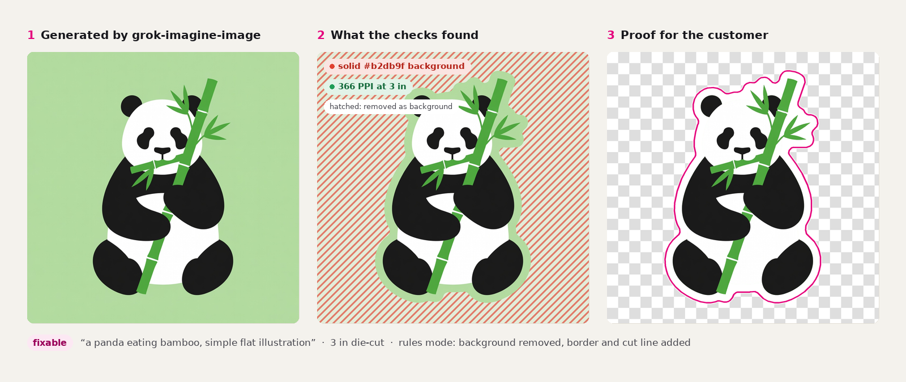
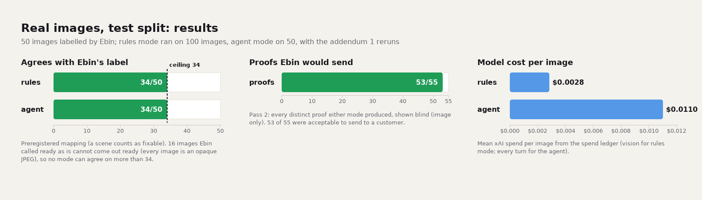
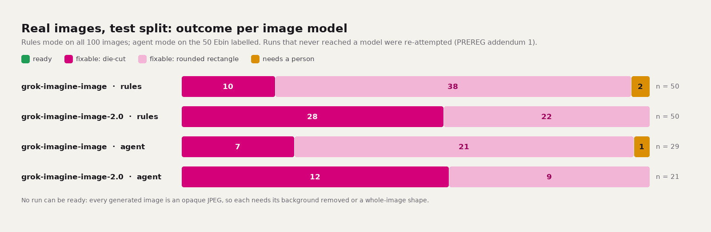
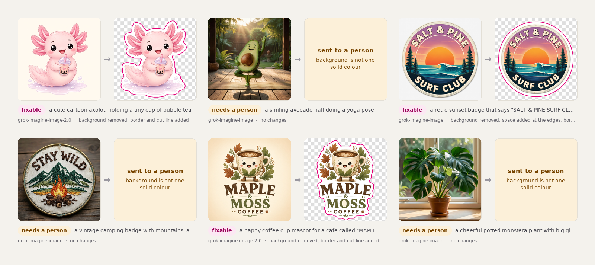

# printready

By Ebin Babu Thomas.

Checks sticker artwork against a printer's published rules at the ordered size and fixes the mechanical problems. It draws the cut line and sends what it cannot fix to a person. Built and scored on AI-generated art. Not affiliated with Sticker Mule; the rules are paraphrased from their public FAQ pages and linked per rule.



## What it found

Of 100 Grok sticker images, 38 became die-cut proofs with a border and cut line. 60 came back as rounded-rectangle proposals because the art was a full scene, and 2 went to a person. The two were one garbled word and one subject cut off at the canvas edge. Ebin, the author, labelled 50 of the images blind before any tool ran, and would send 53 of the 55 distinct proofs to a customer. The fixed pipeline agreed with those labels on 34 of 50, which is the ceiling. 16 of the images were labelled "ready" and are opaque JPEGs, so the tool has to change them and can only answer "fixable". A tool-use agent with the same tools also reached 34 of 50, at four times the cost and twice the time. By the rule written before the run, the agent did not earn its place. Rules mode is the default.

The scene rate is the number a sticker shop would care about. `grok-imagine-image` returned a scene for 39 of 50 prompts; `grok-imagine-image-2.0` for 22 of 50. The prompts were sent as a customer would type them, without a sticker style prefix. One fixed prefix, tried after the fact on the first model, cut its scenes to 3 of 50. That moved more images than any fixer in this repo ([below](#prompt-prefix-experiment-exploratory)).

## Why it exists

Sticker Mule added Grok image generation to its artwork upload in August 2026 and called it a first version. Their FAQ publishes the rules the art has to meet. Among them are 300 PPI at the printed size, a 0.1 in border, 1 pt lines and 6 pt text. Changes go back and forth on a proof page until the customer approves. This repo asks two questions. Can the mechanical part be done while the customer is still there, and does an agent beat a fixed pipeline at it?

## How it works

- **Checks with a source.** The checks are file, resolution at the ordered size, background, soft edges, art cut off at the edge, and separate islands. Each threshold carries a Sticker Mule FAQ URL or is marked `convention` with a reason ([docs/rules.md](docs/rules.md)).
- **Fixes behind a damage guard.** The fixes remove a flat background, pad the canvas, add the white border and the SVG cut line, and grow the border to join islands. After every fix the guard checks the art. Border, pad and bridge must leave every art pixel bit-identical; background removal may erase at most 2 % of real colour. A damaged fix is reverted and the job goes to a person ([guard.py](src/printready/guard.py)).
- **Scenes become a product choice.** When there is no flat background to cut around, `fit_shape` offers a rounded-rectangle sticker of the whole image, cut 1/16 in inside the canvas. A person cutout is the other option. No pixel changes; the customer decides.
- **A model only for text.** The vision model reads the lettering and spells it letter by letter; code decides whether it is garbled. The model cannot measure text size, so `text_small` is off by default ([docs/vision-notes.md](docs/vision-notes.md)). When the model call fails, the check is a skip and the image goes to a person rather than a guess.
- **Two modes, one outcome rule.** Rules mode runs the fixes in a fixed order. Agent mode is a tool-use loop on `grok-4.3` at temperature 0 with the same tools and at most 8 turns. Neither mode picks its own outcome; `outcome()` in [types.py](src/printready/types.py) reads the history and the final checks. The agent stays the default only if it beats rules mode by a rule written before the run.

## Results







**Real set.** 50 prompts, each sent verbatim to `xai:grok-imagine-image` and `xai:grok-imagine-image-2.0`, 100 images, every one judged as a 3 in die-cut order. Ebin labelled 50 of them blind, right after generation. The labels were 28 scenes, 16 ready as a die-cut, 6 fixable as a die-cut, and 0 for a person. Then both modes ran, and Ebin judged every distinct proof with the mode hidden.

The preregistered run hit two outages after [PREREG.md](PREREG.md) was committed. Sixteen vision calls got HTTP 429 with no tokens, and every agent run got HTTP 403 before its first token. Those 66 runs were re-attempted under a declared addendum, written before the rerun, and nothing else changed. The 16 rules reruns reproduced the same `fixed.png` byte for byte. Both runs are reported.

| | preregistered run | rerun (Addendum 1) |
|---|---|---|
| rules mode agrees with the labels | 29 of 50 | 34 of 50 |
| agent mode agrees with the labels | 0 of 50 (never reached the model) | 34 of 50 |
| ceiling under the label mapping | 34 of 50 | 34 of 50 |
| person needed or not, two classes (post hoc) | rules 42, agent 0 | 49 of 50, both |
| rules mode on all 100 (die-cut, rounded rectangle, person) | 30, 52, 18 | 38, 60, 2 |
| cost and time per image, rules | $0.0023, 7.6 s | $0.0028, 8.2 s |
| cost and time per image, agent | $0, 1.0 s | $0.011, 20.0 s |
| verdict by the preregistered rule | keep rules | keep rules |

Of the 18 hand-offs in the preregistered run, 16 were the vision outage. The tool sent those to a person rather than guess. Pass 2 was done once, after the rerun, on the 55 distinct proofs from both runs. 53 were acceptable, with one unacceptable proof per mode and no damaged fixes. Labels were made by Ebin alone; there is no second labeller yet. Full tables in [eval.md](results/realset/test/eval.md); post-hoc views, including product agreement and three customer messages from each mode side by side, in [posthoc.md](results/realset/test/posthoc.md).

**Why the agent tied.** Its prompt restates the rules flowchart, it has the same tools, and the same function decides its outcome. It can tie or lose. It did one thing on its own, handing one image to a person by its own judgement, and it wrote the better customer messages. Neither is in the score.

**Planted-defect benchmark, held out.** 258 of 258 outcomes right on the seed-8 split ([report.md](results/bench/test/report.md)). That is a correctness test, since the generator and the detectors share the rule definitions. Garbled-text detection caught 15 of 16 garbled words with no false flags on 32 clean ones.

**Spend.** About $6.5 of the $10 cap, every call on the committed ledger.

## Prompt prefix experiment (exploratory)

Post hoc, decided after the test results were in, and not preregistered. One model, `grok-imagine-image`, and the same 50 test prompts. Each prompt got one fixed prefix, written once and never tuned: "Die-cut sticker design, single subject, flat plain white background, no scenery, no shadow: ". Rules mode judged both sets with the vision check off. Cost $1.00.

| product, rules mode without vision | unprefixed | prefixed |
|---|---|---|
| die-cut proof | 10 | 47 |
| rounded-rectangle proposal (a scene) | 39 | 3 |
| to a person | 1 | 0 |

The trade-off is size. With the prefix the subject sits smaller on more white space. At a 3 in order the resolution check goes from 44 pass, 5 warn, 1 fail to 9 pass, 40 warn, 1 fail. A warning asks the customer to pick a smaller size; nothing is upscaled. Part of that gap is arithmetic, since a whole-image rectangle uses the full canvas and a cut-out subject does not.

This matters to a sticker shop. The prompt wrapper is one line the shop controls, and on this model it moved more images than any fixer in this repo. Whether Sticker Mule's uploader already adds one is unknown, and nothing here says anything about their setup. Tables in [prefix.md](results/realset/prefix/prefix.md); every original and its proof in [contact-sheet.jpg](results/realset/prefix/contact-sheet.jpg).

## Where an agent would earn its place

The agent had no judgement to make that the rules could not. Version 2 gives it one. On a textured or vignette background, where flood fill is refused today, the model points to a box around the subject. Code segments inside the box. The guard checks the cutout the same way, and Ebin's pass-2 acceptability is the score. New preregistration, new split, and a second labeller.

## Run it

```
uv sync
uv run printready check art.png --size 3
uv run printready fix art.png --size 3                                   # rules mode, no key needed
uv run printready fix art.png --size 3 --mode agent --model xai:grok-4.3   # needs XAI_API_KEY
uv run printready serve --demo --open                                    # local workbench on saved runs
uv sync --extra mcp && uv run printready mcp                             # MCP server, rules mode only
uv run pytest -q                                                         # offline, no key
```

`--size` is the finished sticker's longest side in inches, border included. Outputs per image: `report.json`, `fixed.png`, `cutline.svg`, `proof.png`, `overlay.png`, `report.html`, the customer message, and in agent mode `log.jsonl` with every turn. The MCP server is described in [docs/mcp.md](docs/mcp.md).

**Read these five files.** [types.py](src/printready/types.py) holds the contract and `outcome()`. [guard.py](src/printready/guard.py) is the damage guard. [pipeline.py](src/printready/pipeline.py) is rules mode. [agent.py](src/printready/agent.py) is the tool loop. [vision.py](src/printready/vision.py) is the text check. About 1,500 lines between them; the web UI is optional reading.

## What this does not show

- It says nothing about Sticker Mule's real uploads, their uploader's prompt wrapping or post-processing, their proofing, or their own artwork scan. The images came from the xAI API with our prompts, not from their uploader.
- It says nothing about print results on paper. Nothing was printed. "Passes" means passes the rules in `docs/rules.md`.
- It covers no art other than these two image models and these 50 prompts.
- It has no second labeller. The labels are Ebin's.
- It cannot show whether the tool catches art that needs a person on real images. Ebin labelled none of the 50 that way, so only the benchmark covers it.

## How it was built

Claude Opus 5.5 agents wrote the code from a plan Ebin reviewed step by step. Claude Fable 5.1 wrote this README and gave second opinions on the design, the benchmark and the preregistration. Ebin labelled every image, approved each stage, and typed as little as possible. October 2026. MIT.
