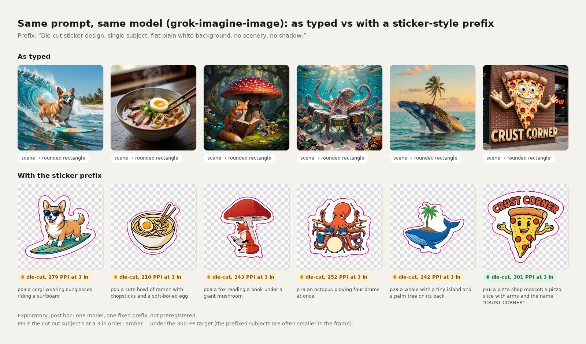
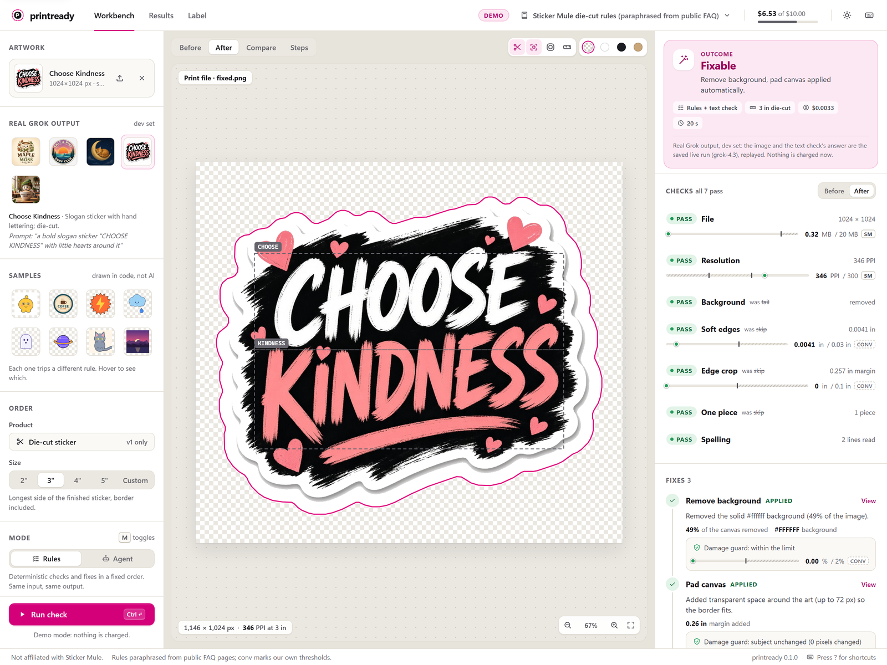
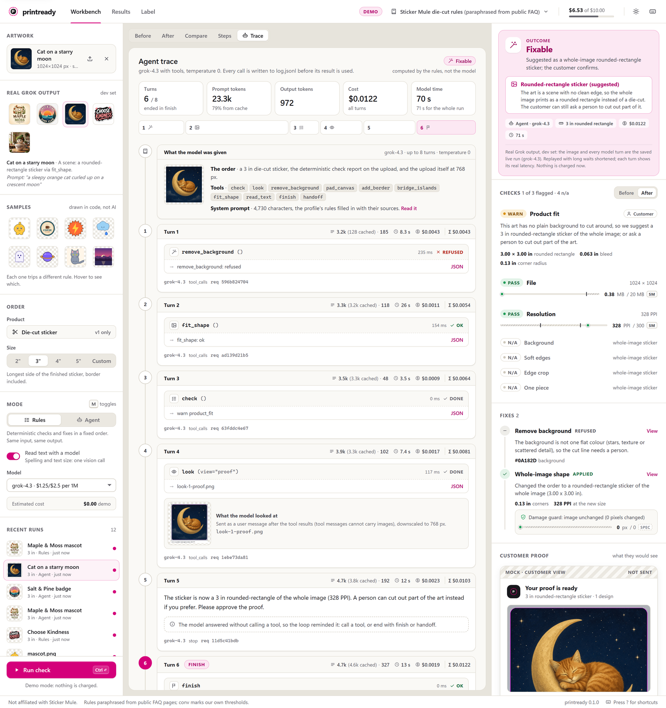

# printready

By Ebin Babu Thomas.

Checks sticker artwork against a printer's published rules at the ordered size and fixes the mechanical problems. It draws the cut line and sends what it cannot fix to a person. Built and scored on AI-generated art. Not affiliated with Sticker Mule; the rules are paraphrased from their public FAQ pages and linked per rule.


## What it found

100 sticker prompts went to the xAI image API as a customer would type them, without a sticker style prefix. The tool found no flat background to cut around in 39 of 50 images from `grok-imagine-image` and 22 of 50 from `grok-imagine-image-2.0`. One fixed prefix, tried after the fact on the first model, cut that to 3 of 50. That moved more images than any fixer in this repo, and it is one line a sticker shop controls ([below](#prompt-prefix-experiment-exploratory)).



On the unprefixed images, rules mode made 38 die-cut proofs with a border and cut line, 60 rounded-rectangle proposals for the scenes, and sent 2 to a person (rerun). The preregistered run, hit by a vision outage, gave 30, 52 and 18. Ebin, the author, labelled 50 of the images blind before any tool ran. Both modes on those 50 produced 55 distinct proofs, and Ebin would send 53 of them to a customer. Rules mode matched 34 of the 50 labels (rerun; 29 in the preregistered run), and 34 is the most any mode could score. 16 images were labelled "ready". Every generated image is an opaque JPEG, so the tool always has to cut it out and calls that "fixable". An agent with the same tools and no decision of its own also scored 34 (rerun), at about four times the cost. The [rule written before the run](PREREG.md) removed it; rules mode is the default. Version 2 gives the agent one decision ([below](#where-an-agent-would-earn-its-place)).

## Why it exists

Sticker Mule added Grok image generation to its artwork upload in its Jul 20 to Aug 2, 2026 changelog and called it a first version. Their FAQ publishes the rules the art has to meet. Among them are 300 PPI at the printed size, a 0.1 in border, 1 pt lines and 6 pt text. Changes go back and forth on a proof page until the customer approves. This repo asks two questions. Can the mechanical part be done while the customer is still there, and does an agent beat a fixed pipeline at it?

## How it works

- **Checks with a source.** The checks are file, resolution at the ordered size, background, soft edges, art cut off at the edge, and separate islands. Each threshold carries a Sticker Mule FAQ URL or is marked `convention` with a reason ([docs/rules.md](docs/rules.md)).
- **Fixes behind a damage guard.** The fixes remove a flat background, pad the canvas, add the white border and the SVG cut line, and grow the border to join islands. After every fix the guard checks the art. Border, pad and bridge must leave every art pixel bit-identical; background removal may erase at most 2 % of real colour. A damaged fix is reverted and the job goes to a person ([guard.py](src/printready/guard.py)).
- **Scenes become a product choice.** When there is no flat background to cut around, `fit_shape` offers a rounded-rectangle sticker of the whole image, cut 1/16 in inside the canvas. A person cutout is the other option. No pixel changes; the customer decides.
- **A model only for text.** The vision model reads the lettering and spells it letter by letter; code decides whether it is garbled. The model cannot measure text size, so `text_small` is off by default ([docs/vision-notes.md](docs/vision-notes.md)). When the model call fails, the check is a skip and the image goes to a person rather than a guess.
- **Two modes, one outcome rule.** Rules mode runs the fixes in a fixed order. Agent mode is a tool-use loop on `grok-4.3` at temperature 0 with the same tools and at most 8 turns. Neither mode picks its own outcome; `outcome()` in [types.py](src/printready/types.py) reads the history and the final checks. The agent would become the default only if it beat rules mode by a rule written before the run.

## Results


**Real set.** 50 prompts, each sent verbatim to `xai:grok-imagine-image` and `xai:grok-imagine-image-2.0`, 100 images, every one judged as a 3 in die-cut order. Ebin labelled 50 of them blind, right after generation. The labels were 28 scenes, 16 ready as a die-cut, 6 fixable as a die-cut, and 0 for a person. Then both modes ran, and Ebin judged every distinct proof with the mode hidden.

The preregistered run hit two outages after [PREREG.md](PREREG.md) was committed. Sixteen vision calls got HTTP 429 with no tokens, and every agent run got HTTP 403 before its first token. Those 66 runs were re-attempted under a declared addendum, written before the rerun, and nothing else changed. The 16 rules reruns reproduced the same `fixed.png` byte for byte. Both runs are reported, and every rerun number below says so.

| | preregistered run | rerun (Addendum 1) |
|---|---|---|
| rules mode matches the labels | 29 of 50 | 34 of 50 |
| agent mode matches the labels | 0 of 50 (never reached the model) | 34 of 50 |
| the most any mode could score | 34 of 50 | 34 of 50 |
| images handed to a person that Ebin would have sent (post hoc) | rules 8, agent 50 | 1 of 50, both |
| rules mode on all 100 (die-cut, rounded rectangle, person) | 30, 52, 18 | 38, 60, 2 |
| cost and time per image, rules | $0.0023, 7.6 s | $0.0028, 8.2 s |
| cost and time per image, agent | $0, 1.0 s | $0.011, 20.0 s |
| verdict by the preregistered rule | keep rules | keep rules |

Of the 18 hand-offs in the preregistered run, 16 were the vision outage. The tool sent those to a person rather than guess. The tool shaped 61 images as a rectangle. One of them, p12, went to a person for a garbled word, which is why the product row says 60. On which product to make (die-cut, rounded rectangle, or a person), rules mode matched Ebin on 43 of 50 (rerun, post hoc). On the same 50 images rules mode averaged 6.6 s, so the agent took about three times the time. Pass 2 was done once, after the rerun, on the 55 distinct proofs from both runs, identical files shown once. Ebin would send 53. The two rejected were the same image, p46, one from each mode; no fix was damaged. Labels were made by Ebin alone; there is no second labeller yet. Full tables in [eval.md](results/realset/test/eval.md); post-hoc views, including product agreement and three customer messages from each mode side by side, in [posthoc.md](results/realset/test/posthoc.md).

**Why the agent tied.** Its prompt restates the rules flowchart, it has the same tools, and the same function decides its outcome. It can tie or lose. Its customer messages were more specific, naming the subject and stating the PPI; that was not scored.

**Planted-defect benchmark, held out.** 258 of 258 outcomes right on the seed-8 split ([report.md](results/bench/test/report.md)). That is a correctness test, since the generator and the detectors share the rule definitions. Garbled-text detection caught 15 of 16 garbled words with no false flags on 32 clean ones. With vision on, outcomes on the 48 text images agree on 39 of 48. The 9 misses are 8 small-text images, since `text_small` is off by design, and 1 garbled word.

**Spend.** About $6.5 of the $10 cap, every call on the committed ledger.

## Prompt prefix experiment (exploratory)

Post hoc, decided after the test results were in, and not preregistered. One model, `grok-imagine-image`, and the same 50 test prompts. Each prompt got one fixed prefix, written once and never tuned: "Die-cut sticker design, single subject, flat plain white background, no scenery, no shadow: ". Rules mode judged both sets with the vision check off. Cost $1.00.

| product, rules mode without vision | unprefixed | prefixed |
|---|---|---|
| die-cut proof | 10 | 47 |
| rounded-rectangle proposal (a scene) | 39 | 3 |
| to a person | 1 | 0 |

The scene count partly measures prompt compliance, since the prefix asks for exactly what the detector checks. The contact sheet is the real evidence. The 3 leftovers (p01, p13, p33) are white-on-white art where background removal is refused, the tool's known limit. The p01 proof is one nobody would send.

The trade-off is size. With the prefix the subject sits smaller on more white space. At a 3 in order the resolution check goes from 44 pass, 5 warn, 1 fail to 9 pass, 40 warn, 1 fail. A warning asks the customer to pick a smaller size; nothing is upscaled. Part of that gap is arithmetic, since a whole-image rectangle uses the full canvas and a cut-out subject does not. At 1k output, a 3 in die-cut needs the subject to span about 840 px for 300 PPI. So the prefix wants 2k output or an upscaler.

This matters to a sticker shop. The prompt wrapper is one line the shop controls, and on this model it moved more images than any fixer in this repo. Whether Sticker Mule's uploader already adds one is unknown, and nothing here says anything about their setup. Tables in [prefix.md](results/realset/prefix/prefix.md); every original and its proof in [contact-sheet.jpg](results/realset/prefix/contact-sheet.jpg).

## Where an agent would earn its place

The agent had no judgement to make that the rules could not. Version 2 gives it one. On a textured or vignette background, where flood fill is refused today, the model points to a box around the subject. Code segments inside the box. The guard checks the cutout the same way, and Ebin's pass-2 acceptability is the score. New preregistration, new split, and a second labeller.

## Run it

Needs Python 3.11+ and `uv`.

```
uv sync
uv run printready check examples/samples/badge.png --size 3
uv run printready fix examples/samples/badge.png --size 3                                   # rules mode, no key needed
uv run printready fix examples/samples/badge.png --size 3 --mode agent --model xai:grok-4.3   # needs XAI_API_KEY
uv run printready serve --demo --open                                                       # local workbench on saved runs
uv sync --extra mcp && uv run printready mcp                                                # MCP server, rules mode only
uv run pytest -q                                                                            # offline, no key
```

`--size` is the finished sticker's longest side in inches, border included. Without `--model` the text check does not run. `serve --demo` builds its demo data on first run, which takes a few minutes. Outputs per image: `report.json`, `fixed.png`, `cutline.svg`, `proof.png`, `overlay.png`, `report.html`, the customer message, and in agent mode `log.jsonl` with every turn. The MCP server is described in [docs/mcp.md](docs/mcp.md).

### Workbench



The workbench runs on 127.0.0.1 and takes a dropped image and a size. It shows the findings, each fix with its damage-guard result, the proof and the customer message.



In agent mode the trace tab streams every turn, with the tool calls, the image the model looked at, and the cost so far.

**Read these five files.** [types.py](src/printready/types.py) holds the contract and `outcome()`. [guard.py](src/printready/guard.py) is the damage guard. [pipeline.py](src/printready/pipeline.py) is rules mode. [agent.py](src/printready/agent.py) is the tool loop. [vision.py](src/printready/vision.py) is the text check. About 1,500 lines between them; the web UI is optional reading.

## What this does not show

- It says nothing about Sticker Mule's real uploads, their uploader's prompt wrapping or post-processing, their proofing, or their own artwork scan. The images came from the xAI image API with our prompts, not from their uploader.
- It says nothing about print results on paper. Nothing was printed. "Passes" means passes the rules in `docs/rules.md`.
- It covers no art other than these two image models and these 50 prompts.
- It has no second labeller. The labels are the author's.
- It cannot show whether the tool catches art that needs a person on real images. Ebin labelled none of the 50 that way, so only the benchmark covers it.

## How it was built

Ebin chose the project, designed the checks, the evaluation and the keep-or-remove rule with the agents, reviewed every stage, and labelled every image. Claude Opus 5.5 agents wrote the code from that plan. Claude Fable 5.1 wrote this README and gave second opinions on the design, the benchmark and the preregistration. October 2026. MIT.
